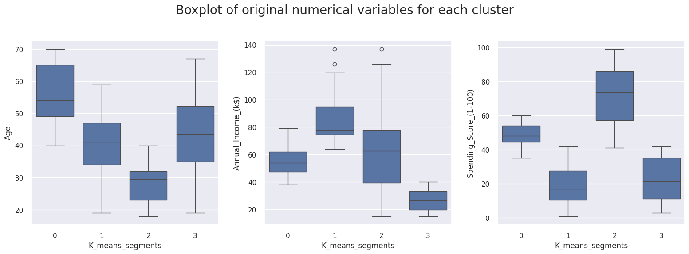

# Customer Segmentation with K-Means

**Four customer segments emerged from 200 mall customer records.** The largest group contained 90 customers and had the highest average spending score. Another group had the highest average income and the lowest spending score.

## Segment profiles

| Cluster | Customers | Avg. age | Avg. annual income ($K) | Avg. spending score | Campaign to test |
| --- | ---: | ---: | ---: | ---: | --- |
| 0 | 47 | 55.6 | 54.4 | 48.9 | Loyalty rewards |
| 1 | 39 | 39.9 | 86.1 | 19.4 | A curated premium offer |
| 2 | 90 | 28.5 | 61.7 | 71.8 | Early access to new products |
| 3 | 24 | 43.1 | 27.0 | 22.1 | Value bundles or targeted discounts |

Spending score is a dataset score on a 1–100 scale. The suggested campaigns are hypotheses to test.

## Method

The notebook standardizes age, annual income, and spending score before fitting K-Means. It compares candidate solutions using elbow and silhouette diagnostics. The final analysis profiles four clusters, although six scored highest in the saved silhouette sweep.

## How to reproduce

1. Open [customer_segmentation.ipynb](customer_segmentation.ipynb) and download [the workbook](Mall_Customers%20dataset.xlsx) into the same directory.
2. Install the notebook dependencies with `pip install numpy pandas matplotlib seaborn scikit-learn scipy yellowbrick openpyxl`.
3. Skip the `!pip nb_black` and Google Drive mount cells. Replace the original CSV import with `data = pd.read_excel("Mall_Customers dataset.xlsx")`, then run the analysis cells in order. The notebook also contains the saved charts and cluster summaries.
